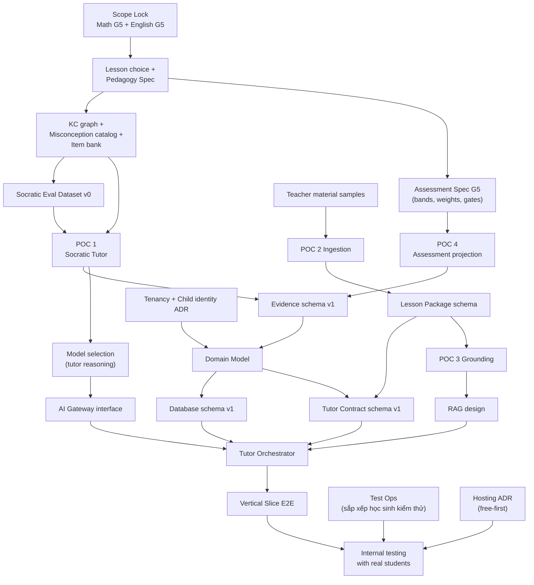

# 02 — Greenfield Strategy · Decision Dependency Graph · Architecture Decision Register · Open Technical Decisions

> PART 6, PART 7, Architecture Decision Register (brief §59/§78) và PART 47.

---

## PART 6 — GREENFIELD DEVELOPMENT STRATEGY

### 6.1. Nguyên tắc chiến lược

1. **Learning system trước, AI sau.** Làm pedagogy spec và assessment spec trước khi viết prompt production. Prompt và policy là *hiện thực hóa* của spec.
2. **Rủi ro cao nhất được kiểm chứng rẻ nhất, sớm nhất.** POC 1 (Socratic) không cần DB, UI hay infra: chỉ cần spec + notebook + eval harness.
3. **Quyết định khó đảo ngược thì chậm và có bằng chứng. Quyết định dễ đảo ngược thì nhanh và mặc định.**
4. **Vertical slice mỏng, xuyên suốt**, thay vì nhiều lớp ngang dở dang.
5. **Mọi kết luận về học sinh phải truy được về evidence.** Việc này thiết kế từ schema đầu tiên, không để "thêm sau".
6. **POC là code vứt đi, có chủ đích.** Code POC nằm trong `poc/` và không được import vào `services/`. Thứ được giữ lại là **dataset, eval, spec và quyết định**.

### 6.2. Bốn track song song ngay từ Ngày 1

```text
Track A — Pedagogy & Assessment Spec   (chủ dự án = giáo viên kiểm soát + AI Eng)
Track B — AI Risk POCs                 (AI Eng, Tech Lead review)
Track C — Foundation                   (Tech Lead + Backend: repo, CI, env, schema lõi, auth)
Track D — Test Ops                     (chủ dự án: sắp xếp học sinh và lịch kiểm thử)
```

Track D không viết code. *(v0.2: phần pháp lý/consent đã được chủ dự án xử lý, D-T2.)* Việc còn lại là sắp xếp học sinh và lịch kiểm thử; nên bắt đầu sớm để không phải chờ khi code xong.

### 6.3. Thứ tự làm việc thực tế

```text
1. Chọn lesson + viết pedagogy spec (K1, K2)             ← không có nó thì không làm gì được
2. Viết eval dataset v0 từ spec (Socratic scenarios)      ← trước cả prompt
3. POC 1: prompt + policy stub + synthetic students      ← kiểm chứng ASSUME-0
4. Assessment Spec G5 + POC 4 (projection deterministic)  ← chốt evidence schema
5. Domain model + ADR khó đảo ngược (tenancy, events, contract, gateway)
6. Foundation code (song song từ bước 1 cho phần không phụ thuộc: repo, CI, auth skeleton)
7. POC 2/3 ingestion + grounding (song song bước 3–4)
8. Runtime production: orchestrator + policy + hint engine + gateway + ledger
9. Vertical slice end-to-end + report
10. Sẵn sàng kiểm thử với học sinh thật (red team, observability, runbook)
```

---

## PART 7 — DECISION DEPENDENCY GRAPH

### 7.1. Đồ thị phụ thuộc tổng thể



### 7.2. Chuỗi phụ thuộc chính (theo brief, đã hiệu chỉnh)

```text
Pedagogy → Learning Model (KC, activity, evidence) → Domain Model → Database
        → Tutor Contract → Tutor Orchestrator → AI Integration
```

Hiệu chỉnh quan trọng: **AI Integration không nằm cuối chuỗi về mặt thời gian.** POC 1 chạy *song song* với Domain Model, vì kết quả POC 1 (model nào, cần structured output gì, evidence gì) làm thay đổi Evidence schema và Tutor Contract. Nói gọn: AI **POC** đi sớm, AI **production integration** đi muộn.

```text
Teacher Content → Ingestion → Lesson Package (approved) → [in-session: context load]
                                                        → [cross-lesson: chunk → embed → retrieve] → Tutor
```

### 7.3. Critical Path

```text
Lesson choice (D2) → Pedagogy spec (D5) → Eval dataset v0 (D6) → POC 1 decision (D12)
→ Evidence schema + Contract schema (D12–14) → Orchestrator core (D15–21)
→ Vertical slice integration (D22–28) → Slice demo & gate (D30)
```

*(v0.2)* Chuỗi Legal/consent → Pilot đã bị gỡ (D-T2). Kiểm thử với học sinh thật chỉ còn phụ thuộc vertical slice ổn định và việc sắp xếp học sinh (Track D).

### 7.4. Không được song song hóa khi dependency chưa giải quyết

- Không viết Assessment module production trước khi Assessment Spec G5 được ký duyệt.
- Không đóng băng DB schema cho evidence trước khi có kết quả POC 1 và POC 4.
- Không build UI teacher report trước khi metric và interpretation được định nghĩa.
- Không tích hợp voice provider trước khi POC 6 chốt kiến trúc (speech-to-speech hay cascade).

---

## ARCHITECTURE DECISION REGISTER

Định dạng mỗi quyết định: Decision → Why → Options → Recommended → Trade-offs → Risk → Reversibility → When to decide → Migration path.
Mỗi ADR sẽ có file riêng trong `docs/adr/` khi được chốt chính thức. Bảng dưới đây là **đề xuất ban đầu**.

### ADR-001 — Kiến trúc tổng thể: Modular Monolith
- **Why:** Team 4–5 người, domain đang học, cần tốc độ iterate. Transaction cần chéo module (session + evidence + student model).
- **Options:** (a) modular monolith; (b) microservices; (c) hybrid: monolith + tách voice gateway.
- **Recommended:** (a) cho MVP. Có đường sang (c) khi voice realtime có nhu cầu scale riêng.
- **Trade-offs:** Deploy chung. Một module lỗi có thể ảnh hưởng toàn bộ → cần module boundary nghiêm ngặt (import rules, không truy cập bảng của module khác).
- **Risk:** Boundary bị xói mòn theo thời gian → kiểm tra bằng lint (import-linter) trong CI.
- **Reversibility:** Trung bình. Tách module thành service dễ nếu boundary sạch.
- **When:** Ngày 7.
- **Migration:** Tách Voice Gateway → tách Ingestion Workers → tách Analytics (CDC).

### ADR-002 — Ngôn ngữ và runtime backend: Python (FastAPI) + Pydantic
- **Why:** AI Eng và backend dùng chung hệ sinh thái. Parsing tài liệu (PyMuPDF, python-pptx), số học chính xác (`fractions`, `decimal`, SymPy), eval và data science, knowledge tracing đều mạnh ở Python.
- **Options:** Python FastAPI; TypeScript (NestJS/Fastify) toàn stack; Go.
- **Recommended:** Python 3.12+ FastAPI cho backend. Frontend TypeScript. Schema dùng chung qua **JSON Schema** sinh từ Pydantic → sinh type TS.
- **Trade-offs:** Hai ngôn ngữ trong repo. Đổi lại dùng đúng công cụ cho AI và dữ liệu.
- **Risk:** Hiệu năng async và WebSocket voice → nếu cần, tách Voice Gateway sang runtime khác.
- **Reversibility:** Khó (toàn bộ code backend).
- **When:** Ngày 5, dựa trên kỹ năng thực tế của team (**[OPEN]**: nếu team mạnh TypeScript hơn hẳn thì đảo lại).
- **Migration:** Không dự kiến.

### ADR-003 — Tenancy: shared DB, `school_id` trên mọi bảng dữ liệu người học + Postgres RLS
- **Why:** Trẻ em → cách ly dữ liệu là bắt buộc. Pilot bắt đầu với 1 trường nhưng sản phẩm hướng tới nhiều trường.
- **Options:** DB per tenant; schema per tenant; shared + RLS.
- **Recommended:** Shared + `school_id` + RLS làm lớp phòng thủ thứ hai (lớp thứ nhất là authorization ở application).
- **Trade-offs:** RLS thêm độ phức tạp cho migration và test. Đổi lại vận hành rẻ.
- **Risk:** Quên `school_id` ở bảng mới → CI test: mọi bảng có `student_id` phải có `school_id` và RLS policy.
- **Reversibility:** **Khó.**
- **When:** Ngày 7.

### ADR-004 — Identity cho học sinh lớp 5: tài khoản do giáo viên cấp, không cần email
- **Recommended:** Student đăng nhập bằng *class code + username + PIN/picture password*, do giáo viên cấp và reset. Parent đăng nhập bằng email/số điện thoại + OTP, liên kết với con qua lời mời của giáo viên. Teacher đăng nhập bằng email + mật khẩu, có thể thêm Google SSO.
- **Trade-offs:** Tự quản lý credential của trẻ → phải có rate limiting và lockout. Không lưu mật khẩu dạng khôi phục được.
- **Reversibility:** Khó (luồng người dùng + dữ liệu).
- **When:** Ngày 7.

### ADR-005 — Event và Evidence: append-only ledger trong Postgres, có version, projection tất định
- **Why:** Replay, audit, knowledge tracing về sau, và yêu cầu "mọi kết luận có evidence".
- **Options:** (a) full event sourcing; (b) state tables + append-only event ledger (event-first cho learning data); (c) chỉ log.
- **Recommended:** (b). Session, Activity, Item state là bảng trạng thái (source of truth cho runtime). Mọi thay đổi đều ghi event trong cùng transaction (transactional outbox). Evidence và Mastery là **projection** tái tạo được từ ledger + policy version.
- **Reversibility:** **Khó** (schema event là hợp đồng dài hạn) → envelope có `schema_version`, cho phép upcaster.
- **When:** Ngày 10–14 (sau POC 1 và POC 4).

### ADR-006 — Tutor Contract: tài liệu JSON bất biến, compile từ Teacher Design, snapshot theo session
- **Recommended:** `ContractCompiler` compile từ LessonVersion + Schedule + Policies (versioned) → `TutorContract` có hash. Session bind với đúng một contract. Teacher sửa lesson → version mới chỉ áp dụng cho session sau. Pause/override là *event*, không sửa contract.
- **Reversibility:** Trung bình (schema có version).
- **When:** Ngày 10–14.

### ADR-007 — AI Gateway theo *model class*, không theo vendor
- **Recommended:** Interface `ModelClass = {TUTOR_REASONING, LIGHTWEIGHT, EVAL_JUDGE, REALTIME_VOICE, EMBEDDING, STT, TTS, PRONUNCIATION}`. Router ánh xạ class → provider/model qua config có version. Business logic chỉ thấy `gateway.tutor_turn(request) -> TutorTurn`.
- **Trade-offs:** Mất một số tính năng riêng của vendor nếu interface quá chung → cho phép *capability flags* (ví dụ `supports_prompt_cache`, `supports_structured_output`).
- **Reversibility:** **Khó nếu không làm từ đầu**, dễ nếu làm đúng.
- **When:** Ngày 10.

### ADR-008 — Hạ tầng lưu trữ MVP: PostgreSQL (+pgvector) + Object Storage
- **Recommended:** Chỉ **2 hệ thống lưu trữ**. Postgres chứa OLTP, event ledger, job queue và vector. Object storage chứa file gốc và audio. Chưa dùng Redis, vector DB riêng hay analytics warehouse.
- **Reversibility:** Dễ để *thêm* sau (Redis, warehouse qua CDC, vector DB riêng).
- **When:** Ngày 7.

### ADR-009 — Kênh realtime cho tutor text: HTTP command + SSE stream
- **Why:** Student action là command (POST, idempotent). Tutor output là stream (SSE). SSE tự reconnect, đi qua proxy dễ, đơn giản hơn WebSocket.
- **Recommended:** SSE cho text. WebSocket/WebRTC chỉ dùng cho voice.
- **Reversibility:** Dễ.

### ADR-010 — Kiểm tra đáp án Toán: deterministic checker + bug library, LLM chỉ phân tích lập luận
- **Why:** LLM có thể tính sai. Assessment phải tất định.
- **Recommended:** `MathChecker` dùng số hữu tỉ chính xác, so sánh tương đương (0,5 = 1/2 = 50% nếu item cho phép), nhận diện misconception bằng luật "buggy rules" (ví dụ đáp án = (a+c)/(b+d) → cộng tử với tử, mẫu với mẫu). LLM phân tích lời giải thích mở và *đề xuất* nhãn. Nhãn phải qua validation layer mới thành evidence.
- **Reversibility:** Dễ.

### ADR-011 — Nơi chạy hệ thống (v0.2: free-first)
- **Options:** (a) Docker Compose trên máy của chủ dự án + **Cloudflare Tunnel** (miễn phí, có HTTPS; trình duyệt chỉ cho dùng micro trên HTTPS) khi kiểm thử; (b) một VM miễn phí (ví dụ Oracle Cloud Always Free, cần kiểm tra điều kiện hiện tại) để chạy 24/7; (c) các PaaS free tier (Render, Supabase/Neon cho Postgres, Cloudflare Pages/Vercel cho frontend), thường ngủ khi không dùng và giới hạn dung lượng; (d) cloud trả phí (GCP Cloud Run + Cloud SQL, phương án v0.1).
- **Recommended:** (a) cho phát triển và các buổi kiểm thử; (b) khi cần demo hoặc kiểm thử không phụ thuộc máy cá nhân. Cùng một `docker-compose.yml` chạy được ở cả hai.
- **Trade-offs:** (a) máy phải bật trong giờ kiểm thử; (b) cấu hình ban đầu lâu hơn; (c) giới hạn tài nguyên, cold start.
- **Reversibility:** Dễ (container hóa từ đầu). Không còn ràng buộc pháp lý về nơi lưu dữ liệu (D-T2).
- **When:** Ngày 7.

### ADR-012 — Voice English: kiến trúc quyết định bởi POC 6
- Xem PART 20. Mặc định tạm: speech-to-speech có orchestrator điều khiển (instructions + tool calls báo evidence), fallback cascade.

### ADR-013 — Monorepo
- **Recommended:** Monorepo (`apps/`, `services/`, `packages/schemas`, `evals/`, `poc/`, `docs/`, `infra/`). Schema dùng chung, một CI, team nhỏ.
- **Reversibility:** Dễ.

### ADR-014 — Frontend: React + TypeScript + Vite (SPA)
- **Why:** App đứng sau login, không cần SEO/SSR. SPA đơn giản.
- **Reversibility:** Dễ đến trung bình.

### ADR-015 — Prompt, policy, rubric là *artifact có version* trong repo, không phải chuỗi rải rác trong code
- **Recommended:** `services/api/tutor/prompts/*.md`, `policies/*.yaml`, `mastery_policy/*.yaml` có `version`. Mọi AI request log ghi version. Mọi thay đổi chạy eval regression.
- **Reversibility:** Dễ, nhưng phải làm từ đầu để có lịch sử.

### ADR-016 — Free-first provider policy (v0.2, D-T4)
- **Decision:** Mỗi model class mặc định dùng lựa chọn **miễn phí** (free tier, mã nguồn mở, chạy local). Dịch vụ trả phí chỉ dùng làm mốc so sánh trong eval, hoặc khi mọi lựa chọn miễn phí không đạt ngưỡng của POC.
- **Why:** Đồ án tốt nghiệp, ngân sách $0.
- **Options:** free tier cloud (Gemini API); mô hình mở chạy local (Ollama, faster-whisper/PhoWhisper, `bge-m3`); trả phí (Claude, OpenAI).
- **Trade-offs:** Hạn mức request tính theo project (xem trong AI Studio) và có thể thay đổi; dữ liệu free tier được Google dùng để cải thiện sản phẩm (chủ dự án chấp nhận, D-T3); model local cần phần cứng.
- **Risk:** Hết hạn mức giữa buổi kiểm thử → fallback chain (model free khác → model local → template đã duyệt) và theo dõi mức tiêu thụ hạn mức trên dashboard.
- **Reversibility:** Dễ, nhờ AI Gateway (ADR-007).
- **When:** Đã chốt (v0.2).

### Phân loại khả năng đảo ngược

| Khó đảo ngược (quyết chậm, có bằng chứng) | Dễ đảo ngược (quyết nhanh, mặc định) |
|---|---|
| Tenancy (ADR-003), Identity trẻ em (ADR-004), Event/Evidence schema (ADR-005), Tutor Contract (ADR-006), AI Gateway abstraction (ADR-007), Ngôn ngữ backend (ADR-002), Domain model và data ownership | UI library, chart library, SSE/WS cho text (ADR-009), embedding model, TTS provider, email/SMS provider, LLM tracing tool, cấu trúc thư mục FE, nơi chạy hệ thống (ADR-011, v0.2), provider free tier cụ thể (ADR-016) |

---

## PART 47 — OPEN TECHNICAL DECISIONS

Định dạng: Unknown → Why it matters → How to validate → Temporary default → Decision deadline.

| # | Unknown | Why it matters | How to validate | Temporary default | Deadline |
|---|---|---|---|---|---|
| O1 | Model nào làm Tutor Reasoning in-session | Chất lượng Socratic, độ trễ, hạn mức free tier | POC 1: cùng eval dataset, so các model free tier (`gemini-3.8-flash`, `gemini-3.5-flash`, `gemini-2.5-pro`); Claude làm mốc nếu có credit | `gemini-3.8-flash` (v0.2) | Ngày 12 |
| O2 | Voice English: speech-to-speech hay cascade | Kiểm soát sư phạm và độ trễ | POC 6: đo latency, tỉ lệ tuân thủ instruction, khả năng log evidence, mức dùng hạn mức/phút | Speech-to-speech (`gemini-3.8-live`, free tier) + orchestrator điều khiển | Trước phase English Speaking |
| O3 | Provider STT tiếng Việt cho Toán | Evidence từ voice phải chính xác | Corpus 200–300 phát ngôn toán lớp 5 (học sinh thật và người lớn, D-T3), đo WER + tỉ lệ parse đúng biểu thức | Miễn phí: Web Speech API (prototype), `gemini-3.5-transcribe-live`, PhoWhisper/faster-whisper local | Phase MVP (tuần 6–8) |
| O4 | Pronunciation assessment cho trẻ em | Tránh chấm sai và bias | Chấm song song với giáo viên, đo agreement | Azure Speech gói F0 miễn phí (5 giờ/tháng; cần xác minh pronunciation assessment có trong F0) | Phase English Speaking |
| O5 | ~~Có được lưu dữ liệu ngoài Việt Nam không~~ | **Đã đóng (v0.2, D-T2):** chủ dự án đã xử lý pháp lý | — | Vẫn tối thiểu hóa PII gửi AI (không tốn chi phí) | Đã đóng |
| O6 | Thời lượng session mặc định | Hiệu quả học, chi phí | Pilot: đo drop-off theo phút, hỏi ý kiến giáo viên | 30 phút | Cuối pilot |
| O7 | Recommendation bands (C2) | Tutor action phụ thuộc band | Pedagogy lead quyết + dữ liệu pilot | Căn theo ranh giới 6 mức hiểu | Ngày 7 |
| O8 | Tutor xưng hô và persona | Trải nghiệm và văn hóa | Chủ dự án quyết định, thử với vài học sinh | "Cô" – "con" | Ngày 5 |
| O9 | Thiết bị học sinh | Mic, trình duyệt, UI | Khảo sát thiết bị của học sinh kiểm thử | Chrome trên tablet/laptop | Ngày 10 |
| O10 | Hạn mức free tier có đủ cho số học sinh kiểm thử không | Quyết định số buổi kiểm thử/ngày | Đọc hạn mức trong AI Studio; đo số request thực mỗi buổi ở POC 1 | Ngân sách $0 (v0.2, D-T4) | Ngày 12 |
| O11 | Bộ SGK tham chiếu | Curriculum Knowledge layer | Chủ dự án chọn (phần pháp lý đã xử lý, D-T2) | Tài liệu giáo viên tự soạn trước, SGK sau | Trước MVP |
| O12 | Thuật toán knowledge tracing | Chất lượng mastery về dài hạn | So sánh Beta-Bernoulli theo chiều vs BKT trên dữ liệu pilot | Beta-Bernoulli theo chiều + công thức M | Sau pilot |
