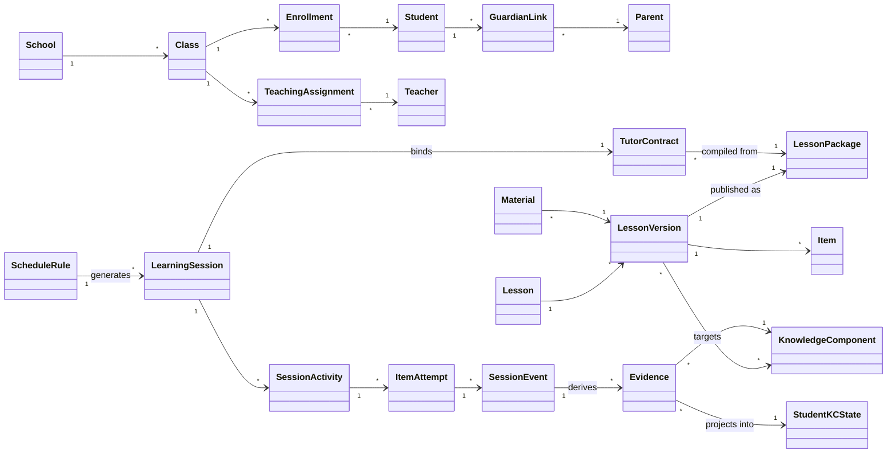
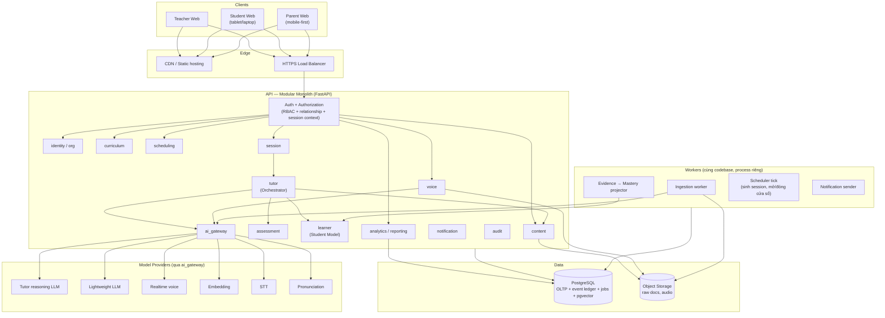
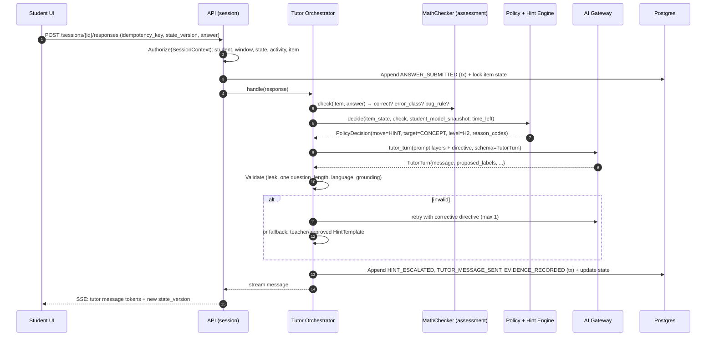

# 03 — Domain Model · System Architecture · Data Architecture

> PART 8 → PART 10.

---

## PART 8 — DOMAIN MODEL

### 8.1. Bounded contexts (module của modular monolith)

| Module | Trách nhiệm | Sở hữu dữ liệu (aggregate) | Không được làm |
|---|---|---|---|
| **identity** | Tài khoản, xác thực, role, guardian link, consent | User, Credential, RoleAssignment, GuardianLink, Consent | Biết về lesson/session |
| **org** | Trường, lớp, ghi danh, phân công giáo viên | School, Class, Enrollment, TeachingAssignment | — |
| **curriculum** | Subject, Grade, KC graph, misconception catalog, skill taxonomy (English) | Subject, GradeLevel, KnowledgeComponent, KCPrerequisite, Misconception, Skill | Chứa dữ liệu học sinh |
| **content** | Lesson, version, material, ingestion, item bank, lesson package, approval | Lesson, LessonVersion, Material, MaterialArtifact, Item, ItemVariant, HintTemplate, LessonPackage, RAGDocument, RAGChunk | Quyết định lịch |
| **scheduling** | Lịch tuần, sinh session, cửa sổ thời gian | ScheduleRule, ScheduleOccurrence | Chạy tutor |
| **session** | Vòng đời LearningSession, binding contract, state 3 tầng, timer, authorization context | LearningSession, TutorContract, SessionActivity, ItemAttempt, SessionStateSnapshot | Tính mastery |
| **tutor** | Orchestrator, policy engine, hint engine, prompt assembly, output validation | TutorRun, TutorTurn, PolicyDecision (dữ liệu nằm trong event ledger) | Ghi trực tiếp Student Model |
| **assessment** | Checker, evidence extraction, scoring, projection mastery/confidence, gates | Evidence, AssessmentResult, MasteryPolicy | Gọi LLM trực tiếp khi chấm tất định |
| **learner** (Student Model) | Hồ sơ học sinh theo KC/skill, misconception profile, behavior metrics | StudentKCState, StudentSkillState, MisconceptionProfile, ReviewSchedule | Bị ghi bởi module khác ngoài projector |
| **analytics / reporting** | Read models, dashboard, report | Views, ReportSnapshot | Sửa dữ liệu nguồn |
| **notification** | Nhắc lịch, báo cáo cho phụ huynh | Notification, DeliveryAttempt | — |
| **voice** | Adapter STT/TTS/realtime, audio storage, math speech normalizer | VoiceStream, AudioAsset, Transcript | Quyết định sư phạm |
| **ai_gateway** | Routing model class → provider, retry, fallback, cost/latency log | ModelRoute, AIRequestLog | Biết về pedagogy |
| **audit** | Audit log truy cập nhạy cảm | AuditEntry | — |

### 8.2. Các khái niệm cốt lõi và quan hệ



### 8.3. Entity bổ sung so với danh sách của brief

Danh sách của brief là điểm bắt đầu. Các entity **còn thiếu** mà hệ thống cần:

| Entity | Lý do |
|---|---|
| School (tenant) | Tenancy và cách ly dữ liệu |
| TeachingAssignment | Teacher ↔ Class ↔ Subject (một lớp có thể có hai giáo viên Toán và Anh) |
| GuardianLink + Consent | Phụ huynh liên kết với con có xác minh; consent có version, phạm vi (voice, transcript, AI) và thời điểm *(v0.2: chỉ là ghi nhận đơn giản, không chặn luồng nào, D-T2)* |
| LessonVersion | Lesson là thực thể sống; version là thứ bất biến được dạy |
| LessonPackage | Gói bất biến đã duyệt mà runtime tiêu thụ (nội dung + items + hints + KC map) |
| MaterialArtifact | Kết quả từng bước ingestion (raw text, page image, extracted structure) để truy vết |
| KnowledgeComponent, KCPrerequisite | Đơn vị đánh giá nhỏ nhất (theo khung Toán §3, §42) |
| Misconception | Catalog có mã, thuộc KC, có "buggy rule" nếu tất định được |
| Skill (English) | `reading.main_idea`, `speaking.interaction`… (theo khung English §3) |
| Item, ItemVariant | Câu hỏi có metadata: KC, cognitive level A–E, difficulty, transfer, expected_time; variant là bài song sinh |
| HintTemplate | Nội dung gợi ý do giáo viên viết hoặc AI sinh rồi được duyệt, theo item × target × level |
| ActivityTemplate | Mẫu hoạt động (CONCEPT_CHECK, GUIDED_PRACTICE…) dùng cho contract |
| ScheduleRule vs ScheduleOccurrence | Lịch lặp và buổi cụ thể (xử lý nghỉ lễ, đổi giờ) |
| ItemAttempt | Một lần học sinh làm một item, có thể nhiều lượt (turn) |
| TutorTurn | Một lượt tutor: directive, model output, validation result |
| PolicyDecision | Quyết định của policy engine (luật nào, input gì) → phục vụ audit Socratic |
| Evidence | Quan sát có cấu trúc, đã validate, gắn KC/skill (khác raw event) |
| AssessmentResult | Kết quả chấm một item/activity (QuestionScore, rubric 0–4) |
| StudentKCState / StudentSkillState | Projection hồ sơ học sinh |
| ReviewSchedule | Lịch kiểm tra retention (T1/T3/T7/T30) |
| TeacherOverride | Ghi đè assessment/mastery, có lý do, có audit |
| AIFlag | Giáo viên đánh dấu lỗi AI trong transcript → đưa vào eval dataset |
| AIRequestLog, RAGRetrievalLog | Observability và cost |
| AudioAsset, Transcript | Voice có vòng đời lưu trữ riêng (retention) |
| AuditEntry | Ai xem transcript, ai export, ai override |
| PolicyVersion (prompt, tutor policy, hint policy, mastery policy) | Truy vết mọi quyết định về đúng version |

### 8.4. Ownership và vòng đời (lifecycle)

| Entity | Owner | Tạo bởi | Bất biến? | Xóa |
|---|---|---|---|---|
| LessonVersion (published) | content | Teacher publish | **Có** | Archive, không xóa nếu đã có session dùng |
| LessonPackage | content | Publish pipeline | **Có** | Theo LessonVersion |
| TutorContract | session | ContractCompiler khi session READY | **Có** | Theo retention của session |
| SessionEvent | session/tutor | Runtime | **Có** (append-only) | Theo retention policy; ẩn danh hóa khi xóa tài khoản |
| Evidence | assessment | Evidence extractor | **Có**. Sửa sai bằng *evidence mới* (supersedes) | Như trên |
| StudentKCState | learner | Projector | Không (projection) | Tái tạo được |
| TeacherOverride | assessment | Teacher | **Có** | Theo audit retention |
| AudioAsset | voice | Voice pipeline | Có | Mặc định 90 ngày **[ASSUME]**, trừ khi bị flag |

---

## PART 9 — SYSTEM ARCHITECTURE

### 9.1. Tổng quan



### 9.2. Luồng một lượt tutor (text, Math)



Điểm then chốt: **policy quyết định *nước đi* (move) trước khi gọi LLM.** LLM chỉ diễn đạt nước đi đó và đề xuất nhãn phân tích.

### 9.3. Vì sao chọn modular monolith (trả lời brief §44, §61)

| Tiêu chí | Modular monolith | Microservices | Hybrid (monolith + voice gateway) |
|---|---|---|---|
| Team 4–5 người | ✅ phù hợp | ❌ overhead vận hành lớn | ✅ khi có voice |
| Transaction chéo module (session + evidence) | ✅ một DB transaction | ❌ saga/outbox phức tạp | ✅ |
| Tốc độ iterate khi domain còn thay đổi | ✅ refactor dễ | ❌ đổi contract giữa service chậm | ✅ |
| Realtime voice (kết nối dài, scale khác) | ⚠️ được ở quy mô nhỏ | ✅ | ✅ |
| Chi phí vận hành | Thấp | Cao | Thấp–trung bình |

**Quyết định:** modular monolith cho MVP. Voice Gateway là ứng viên tách đầu tiên (phase English Speaking) nếu số kết nối đồng thời hoặc runtime yêu cầu.

---

## PART 10 — DATA ARCHITECTURE

### 10.1. Phân tích trước khi chọn DB (theo brief §43)

> **v0.3 (D-T7):** database là **MongoDB Atlas gói M0**, file gốc và audio trên ổ đĩa local (ADR-008). Cột "Lưu ở" dưới đây đã cập nhật; v0.1 chọn PostgreSQL + Object Storage. **[FACT]** Giới hạn M0: 0,5 GB, 100 ops/s, không có multi-document transaction, không có Atlas Search/Vector Search, không có backup.

| Loại dữ liệu | Consistency | Transaction | Truy vấn | Khối lượng (đồ án: vài lớp) | Lưu ở (v0.3) |
|---|---|---|---|---|---|
| Identity, org, enrollment | Mạnh | Không cần (ghi một document) | Theo khóa, theo lớp | Nhỏ | `users`, `schools`, `classes`, `enrollments` |
| Content, lesson version, item bank | Mạnh | Không cần | Theo lesson + version | Nhỏ | `lessons` (mỗi version một document, package nhúng trong đó) |
| Session state (3 tầng) | Mạnh, optimistic locking (`state_version`) | Atomic nhờ **cùng document** với event | Theo khóa | Nhỏ | `learning_sessions` |
| Event ledger | Append-only, thứ tự trong session | Như trên | Theo session/student/time | ~40–80 event/buổi | Mảng `events` trong `learning_sessions` (nguồn sự thật) + bản copy trong `events` để truy vấn chéo session |
| Evidence | Append-only | Không | Theo student × KC | Trung bình | `evidence` |
| Student Model (projection) | Eventual (giây) | Không bắt buộc | Theo student, class | Nhỏ | `student_kc_states` |
| RAG chunks | Eventual | Không | Theo scope lesson | Nhỏ | Context loading từ lesson package; truy xuất khác làm trong Python (M0 không có Vector Search, PART 21) |
| Raw docs, audio | — | — | Theo key | Lớn (audio) | Ổ đĩa local `var/storage/` |
| Analytics | Eventual | Không | Aggregate | Nhỏ | Aggregation pipeline trên `events`, `evidence` |
| Jobs (copy event, projection) | At-least-once, idempotent | Không | Queue | Nhỏ | Chạy trong process (con trỏ `events_copied_upto`); queue riêng khi cần |

**Kết luận (v0.3):** vì M0 không có transaction nhiều document, mọi thứ phải đổi cùng nhau (state 3 tầng + event của một command) nằm trong **một document** `learning_sessions` và được ghi bằng một `find_one_and_update` có điều kiện `state_version` (ADR-005). Các collection còn lại chỉ nhận ghi một document mỗi lần. Tenancy do `TenantScopedRepository` bảo đảm (ADR-003). Tầng dữ liệu: `services/api/cavat/core/repository.py` và `cavat/modules/*/repository.py`.

**[ASSUME]** Dung lượng: một buổi học ≈ 40–80 event × ~0,5 KB ≈ 20–40 KB cho document session, cộng bản copy trong `events`. 0,5 GB đủ cho vài nghìn buổi học (quy mô đồ án). Audio không vào database.

### 10.2. Phân tầng dữ liệu đánh giá (brief §37, §38)

```text
L0  Raw Event          SessionEvent (append-only, bất biến, có payload đầy đủ)
L1  Learning Evidence  Evidence (đã validate: KC/skill, construct, support level, validity)
L2  Derived Features   per-evidence features (independence_weight, difficulty_weight, error_class…)
L3  Assessment         AssessmentResult (QuestionScore / rubric 0–4)
L4  Metric             StudentKCState / StudentSkillState (mastery, confidence, chiều)
L5  Interpretation     Trạng thái (NOT_LEARNED… MASTERED_STABLE), nhận xét theo template
L6  Recommendation     Hành động tutor tiếp theo / gợi ý cho giáo viên
```

Mỗi bản ghi ở L1–L6 mang `source_ids` (tham chiếu tầng dưới) + `policy_version`. **Truy vết ngược luôn được**: từ một câu trong báo cáo phụ huynh → metric → assessment → evidence → event → transcript turn.

### 10.3. Event envelope (chuẩn chung)

```json
{
  "event_id": "uuid-v7",
  "event_type": "ANSWER_SUBMITTED",
  "schema_version": 1,
  "occurred_at": "2026-10-12T08:15:02.123Z",
  "recorded_at": "2026-10-12T08:15:02.140Z",
  "school_id": "uuid",
  "student_id": "uuid",
  "session_id": "uuid",
  "contract_id": "uuid",
  "activity_id": "uuid|null",
  "item_attempt_id": "uuid|null",
  "sequence_no": 57,
  "actor": { "type": "student|tutor|system|teacher", "id": "uuid|null" },
  "correlation": { "tutor_run_id": "uuid|null", "model_request_id": "uuid|null", "rag_request_id": "uuid|null", "trace_id": "hex" },
  "idempotency_key": "string|null",
  "payload": { }
}
```

`sequence_no` tăng dần trong mỗi session (unique `(session_id, sequence_no)`) để đảm bảo thứ tự và replay.

**v0.3 (MongoDB):**
- Envelope nằm trong mảng `events` của document `learning_sessions`. Repository tự điền `event_id` (UUIDv7), `school_id`, `student_id`, `session_id`, `contract_id`, `sequence_no`, `recorded_at`; caller chỉ đưa `event_type`, `payload`, `actor`, `activity_id`, `item_attempt_id`, `correlation` (`NewEvent` trong `cavat/modules/session/repository.py`).
- `sequence_no` được cấp từ `next_sequence_no` của document và chỉ được ghi khi `state_version` còn khớp, nên không có hai event cùng số.
- `idempotency_key` của command được ghi vào mọi event của command đó; command trùng key bị từ chối (`DuplicateCommand`), không tạo event trùng.
- Bản copy trong collection `events` dùng `_id = event_id` và unique index `(session_id, sequence_no)`; copy lặp lại không tạo bản ghi trùng.

### 10.4. Danh mục event (tối thiểu của brief + bổ sung)

| Nhóm | Event | Payload chính |
|---|---|---|
| Lifecycle | `SESSION_SCHEDULED`, `SESSION_READY`, `CONTRACT_BOUND`, `SESSION_STARTED`, `SESSION_PAUSED`, `SESSION_RESUMED`, `SESSION_INTERRUPTED`, `SESSION_EXITED`, `SESSION_COMPLETED`, `SESSION_ABANDONED`, `SESSION_MISSED`, `SESSION_FAILED`, `SESSION_CANCELLED`, `STATE_TRANSITIONED`, `TIME_WARNING` | from/to state, reason, remaining_time |
| Activity | `ACTIVITY_STARTED`, `ACTIVITY_COMPLETED`, `ACTIVITY_SKIPPED` | activity_type, mandatory, skip_reason |
| Item | `QUESTION_SHOWN`, `ANSWER_SUBMITTED`, `ANSWER_CHANGED`, `STEP_SUBMITTED`, `EXPLANATION_SUBMITTED`, `ANSWER_CORRECT`, `ANSWER_WRONG`, `ANSWER_PARTIAL`, `RETRY_STARTED`, `ITEM_RESOLVED` | item_id, variant, raw_answer, normalized_answer, check_result, attempt_no, latency_ms, input_modality |
| Tutor | `TUTOR_MESSAGE_SENT`, `POLICY_DECISION`, `HINT_REQUESTED`, `HINT_ESCALATED`, `HINT_DELIVERED`, `MISCONCEPTION_DETECTED`, `VERIFICATION_ASKED`, `OUTPUT_REJECTED`, `MODEL_FALLBACK`, `MODEL_CALLED` (ADR-032) | move, hint_level, hint_target, reason_codes, rule_id, prompt_version, validation_errors; model, prompt/completion tokens |
| Voice | `VOICE_STARTED`, `VOICE_UTTERANCE`, `VOICE_INTERRUPTED`, `VOICE_ENDED`, `VOICE_FALLBACK_TO_TEXT` | audio_ref, transcript, asr_confidence, duration_ms, latency_ms |
| Assessment | `EVIDENCE_RECORDED`, `EVIDENCE_REJECTED`, `ASSESSMENT_COMPUTED`, `MASTERY_UPDATED`, `TEACHER_OVERRIDE` | evidence_ids, policy_version, before/after |
| Teacher | `TUTOR_PAUSED_BY_TEACHER`, `TRANSCRIPT_VIEWED`, `AI_FLAGGED` | reason |

JSON Schema của từng payload nằm ở `packages/schemas/events/`. CI kiểm tra mọi event được ghi đều validate.

### 10.5. AI Memory (brief §42)

| Loại | Nội dung | Lưu ở | Đưa vào prompt thế nào |
|---|---|---|---|
| Session Memory | Hội thoại của session hiện tại, item state | Event ledger + state | Toàn bộ lượt của **item hiện tại**; tóm tắt có cấu trúc các item đã xong (không đưa nguyên văn) |
| Lesson Context | Lesson package đã duyệt | LessonPackage | Nạp nguyên, có cache (prefix ổn định) |
| Student Memory | Snapshot Student Model cho các KC của lesson + top misconception + sở thích tương tác (ví dụ thích ví dụ về bóng đá) | learner | Khối "Student Snapshot" ngắn (≤ 400 token), sinh tất định |
| Long-Term History | Mọi session cũ | Event ledger | **Không** đưa vào prompt. Chỉ truy xuất *có chủ đích* (ví dụ lỗi cũ trên cùng KC) qua query có cấu trúc, không qua vector search trên transcript |

Nguyên tắc: **memory của AI ≠ evidence của học sinh.** Việc tutor "nhớ" không phải là bằng chứng học sinh biết (khung English §12.1).
