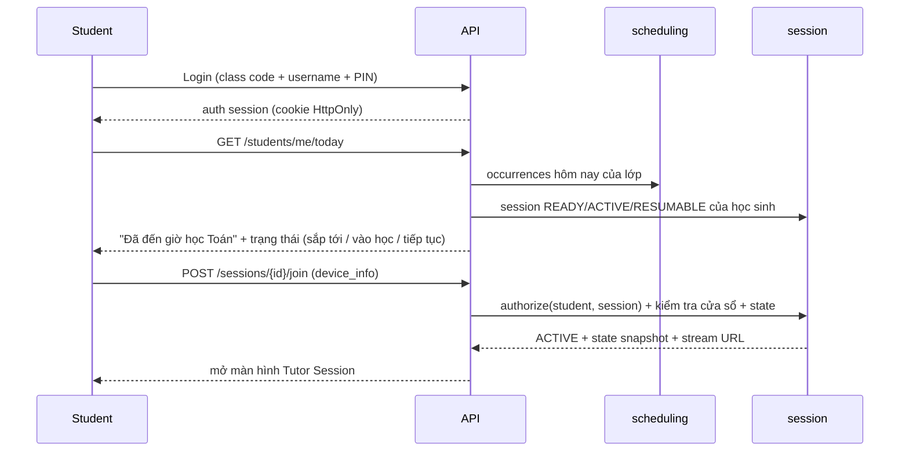

# 08 — Scheduler · Session Control

> PART 23, PART 24 (gồm brief §28, §31–§34, §64).

---

## PART 23 — SCHEDULER

### 23.1. Mô hình

| Entity | Ý nghĩa | Ai tạo/sửa |
|---|---|---|
| `ScheduleRule` | Lịch lặp: lớp, môn, thứ trong tuần, giờ bắt đầu, thời lượng, khoảng ngày áp dụng, timezone (`Asia/Ho_Chi_Minh`) | Teacher |
| `LessonAssignment` | Gán lesson (hoặc chuỗi lesson) vào các buổi: cố định theo ngày hoặc "lesson tiếp theo trong kế hoạch" | Teacher |
| `ScheduleOccurrence` | Một buổi cụ thể (ngày giờ, lesson, trạng thái: planned, cancelled, moved) | Sinh từ rule; teacher chỉnh ngoại lệ |
| `LearningSession` | Buổi học của **một học sinh** ứng với một occurrence | Scheduler sinh |
| `ReviewSchedule` | Lịch kiểm tra retention (T1, T3, T7, T30) cho KC | Assessment/learner sinh; scheduler nhúng vào session sau |

### 23.2. Luồng scheduler

```text
Teacher tạo/sửa ScheduleRule + LessonAssignment
   └─► Scheduler (worker, tick mỗi phút + khi có thay đổi):
        1. Materialize occurrences cho 14 ngày tới (idempotent)
        2. Với mỗi occurrence × học sinh đang ghi danh → LearningSession(SCHEDULED)
        3. T-10 phút: ContractCompiler → TutorContract → SESSION_READY (nếu lesson chưa publish → cảnh báo giáo viên, session chuyển BLOCKED_NO_CONTENT)
        4. Hết cửa sổ vào (start + joinLateLimit) mà chưa join → SESSION_MISSED
        5. Hết cửa sổ session → đóng các session EXITED/INTERRUPTED/PAUSED → INCOMPLETE
        6. Gửi nhắc giờ học (notification) theo cấu hình
```

- **Preview:** giáo viên có thể gắn preview (bài đọc trước, video ngắn) mở sẵn trước buổi học. Preview **không** mở tutor session.
- **Homework:** là một loại session riêng (`kind = HOMEWORK`) có cửa sổ dài (ví dụ 48 giờ), contract riêng (hint policy nới hơn, không có exit assessment chính thức). Đề xuất đưa vào **sau MVP**.
- **Ngoại lệ:** nghỉ lễ, đổi giờ, học bù. Giáo viên sửa occurrence; session đã sinh được cập nhật nếu còn SCHEDULED, nếu đã READY thì cần hủy và tạo lại.

### 23.3. Quyền

- Chỉ Teacher (được phân công lớp và môn đó) và School Admin mới tạo hoặc sửa lịch.
- Student và Parent **chỉ đọc**. Student không có API nào ghi lịch (không chỉ ẩn nút; endpoint không tồn tại với role student).

---

## PART 24 — SESSION CONTROL

### 24.1. Luồng đăng nhập vào buổi học (brief §31)



### 24.2. SessionContext và authorization (brief §32, §64)

Mọi request liên quan tới tutor session đi qua middleware `SessionAuthorizer` tạo ra `SessionContext`:

```python
@dataclass(frozen=True)
class SessionContext:
    user: AuthenticatedUser           # ai đang gọi
    student_id: UUID                  # học sinh của session
    session: LearningSessionRow       # đã lock
    schedule_occurrence_id: UUID
    contract: TutorContract           # snapshot bất biến
    lifecycle_state: LifecycleState   # tầng 1
    activity: ActivityState | None    # tầng 2
    item: ItemState | None            # tầng 3
    now: datetime                     # thời gian server (không tin đồng hồ client)
    allowed_commands: frozenset[CommandType]
```

Kiểm tra bắt buộc (thiếu một điều kiện nào thì **reject** với mã lỗi rõ ràng):

| Kiểm tra | Lỗi |
|---|---|
| `user` là student của session (hoặc teacher được phân công, với các command dành cho teacher) | 403 `NOT_SESSION_OWNER` |
| `now` nằm trong cửa sổ của occurrence (± grace) | 409 `OUTSIDE_SESSION_WINDOW` |
| `lifecycle_state` cho phép command | 409 `INVALID_STATE` |
| Command thuộc `allowed_commands` của activity hiện tại | 409 `COMMAND_NOT_ALLOWED_IN_ACTIVITY` |
| `item_id` trong request = item hiện tại | 409 `STALE_ITEM` |
| `expected_state_version` = version hiện tại | 409 `STATE_VERSION_CONFLICT` (client đồng bộ lại) |
| `idempotency_key` đã xử lý | 200 với kết quả cũ (không xử lý lại) |
| Body **không** chứa tham số model, lesson, activity do client chọn | 400 (schema không có các trường này) |

Frontend ẩn nút chỉ là **UX**. Toàn bộ an toàn nằm ở backend. Có bộ test "authorization matrix" (role × state × command) chạy trong CI.

### 24.3. Student control và pedagogy (brief §33)

Mục tiêu: giữ tính toàn vẹn của buổi học mà không biến trải nghiệm thành cưỡng ép. Nghiên cứu về động lực học tập (lý thuyết tự quyết, *self-determination theory*) cho thấy cảm giác tự chủ giúp duy trì động lực. Vì vậy ta trao cho học sinh các lựa chọn **nhỏ nhưng thật**.

| Loại | Ví dụ | Enforce |
|---|---|---|
| **Hard constraints** (bắt buộc) | Lesson, giờ học, activity bắt buộc, exit assessment, không đổi model, không xem đáp án assessment, không bỏ qua câu trong assessment, không mở lesson khác trong giờ | Backend reject |
| **Soft constraints** (nhắc, gợi ý) | "Mình nghỉ 1 phút nhé?", "Con muốn xem lại ví dụ không?", nhắc thời gian còn lại, gợi ý thử tự làm trước khi xin gợi ý | Tutor/UI gợi ý, học sinh có thể từ chối |
| **Micro choices** (lựa chọn thật trong khuôn khổ) | Chọn giữa 2 bài song sinh (bài về bánh hay về dây ruy băng); chọn loại gợi ý (gợi ý nhỏ hay ví dụ tương tự); chọn cách trả lời (gõ hoặc nói); chọn thứ tự làm các bài trong một nhóm practice; xin tạm dừng (tối đa 2 lần × 5 phút); chọn nhân vật hoặc avatar tutor; chọn chủ đề ví dụ yêu thích (thể thao, động vật) | Được ghi event; mọi lựa chọn đều nằm trong tập mà contract cho phép |

Nguyên tắc: **học sinh chọn "đường đi", hệ thống giữ "đích đến".** Không có lựa chọn nào làm giảm evidence bắt buộc hoặc bỏ qua mục tiêu.

Tránh phản sư phạm:
- Không khóa học sinh vô thời hạn trong một câu. R-FRUSTRATION (PART 15) luôn đưa đến lối thoát có hướng dẫn.
- Không phạt khi xin gợi ý. Gợi ý chỉ ảnh hưởng *trọng số evidence*, không hiển thị như "bị trừ điểm".
- Không dùng ngôn ngữ đe dọa ("nếu không làm sẽ…").
- Cho phép "Con muốn nói với cô giáo" (flag cho giáo viên), là kênh thoát an toàn.

### 24.4. Pause, exit, resume, disconnect

| Sự kiện | Hành vi | Evidence |
|---|---|---|
| Student pause | Dừng timer active (không dừng cửa sổ). Tối đa theo `studentMayPause` | `SESSION_PAUSED` |
| Teacher pause (override) | Dừng tutor ngay, hiện thông báo cho học sinh | `TUTOR_PAUSED_BY_TEACHER` |
| Student thoát | EXITED, `resumable_until = window_end` | `SESSION_EXITED` |
| Mất kết nối | Heartbeat SSE mỗi 15s; > 60s → INTERRUPTED | `SESSION_INTERRUPTED` |
| Quay lại | Snapshot từ server; tiếp tục đúng item. Tutor chào lại ngắn, không lặp nội dung | `SESSION_RESUMED` |
| Refresh trình duyệt | Như quay lại (không tạo session mới) | — |
| Hết cửa sổ khi chưa xong | INCOMPLETE; evidence giữ nguyên; báo giáo viên và phụ huynh | `SESSION_ABANDONED` (reason) |

### 24.5. Teacher live controls

- Xem danh sách học sinh đang học (trạng thái, activity, cờ "cần chú ý").
- Pause hoặc resume tutor của một học sinh; kết thúc sớm; cộng thêm thời gian (tối đa theo policy).
- Xem transcript realtime (được audit).
- Gửi một tin nhắn giáo viên vào session. Tin nhắn hiển thị khác màu, không đi qua LLM.
