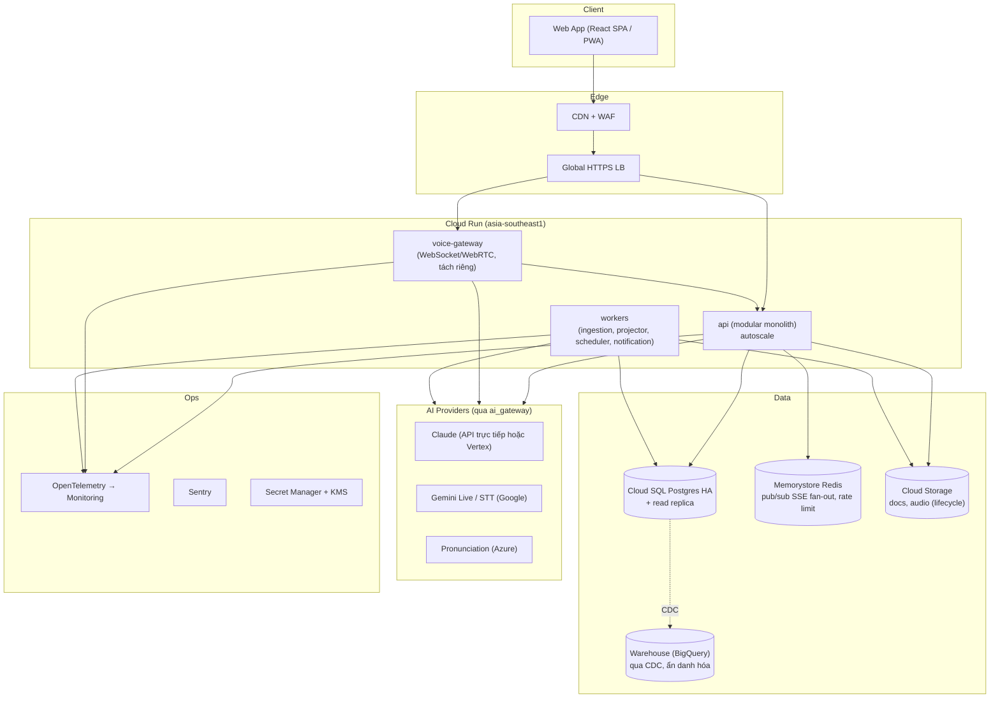

# 13 — Production Architecture · Tech Stack · Development Foundation · Team Model · Parallel Workstreams

> PART 37 → PART 40, gồm Development Foundation (brief §60).

---

## PART 37 — PRODUCTION ARCHITECTURE

### 37.1. Kiến trúc đích (sau pilot, ~1,000–10,000 học sinh)



### 37.2. Lộ trình tiến hóa từ MVP

| Bước | Kích hoạt khi | Thay đổi |
|---|---|---|
| MVP | — | 1 service api + 1 service worker, Cloud SQL đơn, GCS |
| +Redis | Nhiều instance api cần fan-out SSE, rate limit phân tán | Memorystore |
| +Voice Gateway | Phase English Speaking | Service riêng, kết nối dài, scale theo concurrent streams |
| +HA + replica | Pilot có học sinh thật | Cloud SQL HA, PITR, replica cho reporting |
| +Warehouse | Cần phân tích cohort và nghiên cứu | CDC → BigQuery (ẩn danh hóa) |
| Region trong nước | Nếu pháp lý yêu cầu (O5) | Di chuyển DB và storage; giữ AI provider qua cơ chế tối thiểu hóa dữ liệu |

### 37.3. Mục tiêu vận hành production

SLO: tutor turn TTFT p95 ≤ 2s; availability 99.5% trong khung giờ học; RPO ≤ 5 phút (PITR); RTO ≤ 1 giờ. Load target: 2,000 session đồng thời (giả sử 10,000 học sinh, 20% học cùng khung giờ).

---

## PART 38 — TECH STACK

Mỗi lựa chọn có: Lý do · Trade-off · Chi phí · Khả năng đảo ngược.

| Lớp | Lựa chọn | Lý do | Trade-off | Chi phí | Đảo ngược |
|---|---|---|---|---|---|
| **Frontend** | React + TypeScript + Vite (SPA/PWA), TanStack Query, Tailwind; KaTeX hiển thị toán; Web Audio cho mic | Sau login, không cần SSR; hệ sinh thái lớn; PWA đủ cho tablet | Không SEO (không cần) | $0 (hosting tĩnh) | Dễ |
| **Backend** | Python 3.12+, FastAPI, Pydantic v2, SQLAlchemy 2 + Alembic | AI/eval/parsing/số học chính xác; schema Pydantic → JSON Schema dùng chung | Hai ngôn ngữ trong repo | — | **Khó** |
| **Database** | PostgreSQL 16+ (Cloud SQL) + pgvector | Một hệ thống cho OLTP, event, job, vector; RLS | Phải tự quản partition và vacuum cho bảng event | ~$10–300/tháng theo quy mô | **Khó** (dữ liệu) |
| **Cache** | Chưa dùng ở MVP → Memorystore Redis khi scale | Tránh hệ thống thừa | — | ~$35+/tháng khi thêm | Dễ |
| **Queue** | Postgres-backed queue (Procrastinate) + transactional outbox | Cùng transaction với dữ liệu; không thêm hạ tầng | Throughput thấp hơn broker chuyên dụng (đủ cho MVP) | $0 | Dễ (sang Pub/Sub) |
| **Object Storage** | Google Cloud Storage (bucket riêng cho docs và audio, lifecycle rule) | Rẻ, signed URL, lifecycle | — | ~$0.02/GB-tháng | Dễ |
| **Search** | Postgres full-text (tsvector + unaccent) | Đủ cho tìm tài liệu giáo viên | Tiếng Việt cần xử lý dấu | $0 | Dễ |
| **Vector DB** | pgvector (HNSW) | Filter theo scope ngay trong SQL; quy mô nhỏ | Kém hơn vector DB chuyên dụng ở hàng trăm triệu vector | $0 | Dễ |
| **AI — tutor** | `claude-opus-5-5` (mặc định tạm), so sánh với `claude-sonnet-5-5` và 1 ứng viên khác trong POC 1 | Tuân thủ instruction, structured output, prompt cache, mid-conversation system messages | Chi phí output; thinking không tắt được trên Opus 5.5 (chỉ chỉnh effort) | $4/$20 per 1M (Opus 5.5) | Dễ (qua Gateway) |
| **AI — lightweight** | `claude-haiku-4-5` | Rẻ, nhanh | Chất lượng thấp hơn cho dạy | $1/$5 per 1M | Dễ |
| **Embedding** | Gemini Embedding 2 hoặc `text-embedding-3-small` | Đa ngôn ngữ | Re-embed khi đổi | $0.02–0.20 per 1M | Dễ |
| **STT** | Chọn sau spike: Google STT (Chirp), `gpt-4o-transcribe` ($0.006/phút), Gemini Transcribe Live | vi-VN streaming | Độ chính xác với trẻ em chưa biết | ~$0.005–0.017/phút | Dễ |
| **Voice realtime** | Theo POC 6: `gemini-3.8-live` ($0.005/phút in, $0.018/phút out) hoặc `gpt-realtime-2.1-mini`, hoặc cascade | Latency | Kiểm soát sư phạm (PART 20) | Xem PART 32 | Trung bình |
| **Pronunciation** | Azure Pronunciation Assessment | Điểm theo từ/âm vị | Giá chưa xác minh; thêm vendor | [OPEN] | Dễ |
| **Math engine** | Python `fractions`/`decimal` + SymPy (khi cần) | Chính xác tuyệt đối | — | $0 | Dễ |
| **Doc parsing** | PyMuPDF, python-pptx, LibreOffice headless (render) + LLM vision | Hiệu quả với PDF/PPTX | License PyMuPDF là AGPL/thương mại → **cần kiểm tra** hoặc dùng pypdfium2 | $0 / license | Dễ |
| **Auth** | Tự xây trên thư viện đã kiểm chứng (argon2-cffi, itsdangerous/sessions), OIDC cho Google SSO | Tài khoản trẻ không email là đặc thù; SaaS auth thường không hợp | Tự chịu trách nhiệm bảo mật → security review | $0 | **Khó** |
| **Monitoring** | OpenTelemetry + Cloud Monitoring/Logging, Sentry, (tùy chọn) Langfuse self-host | Chuẩn mở, dễ đổi backend | — | $0–200/tháng | Dễ |
| **Deployment** | Docker → Cloud Run; Terraform cho hạ tầng; GitHub Actions CI/CD | Serverless container, scale-to-zero cho staging | Giới hạn kết nối dài (voice gateway cần cấu hình riêng) | Theo dùng | Trung bình |
| **E2E test** | Playwright | Test UI + SSE | — | $0 | Dễ |
| **Load test** | k6 | Script JS, hỗ trợ SSE/WS | — | $0 | Dễ |

---

## DEVELOPMENT FOUNDATION (brief §60)

### Repository (monorepo)

```text
EduAISupport/
├── CLAUDE.md                     # quy ước cho mọi phiên AI (local/cloud)
├── README.md
├── docs/
│   ├── blueprint/                # tài liệu này
│   ├── adr/                      # ADR-001… (mỗi quyết định một file)
│   ├── pedagogy/                 # lesson specs, KC, misconception, assessment spec G5
│   └── poc/                      # decision memo của POC
├── packages/
│   └── schemas/                  # JSON Schema: tutor-contract, events, tutor-turn, lesson-package (nguồn sự thật)
├── services/
│   └── api/                      # FastAPI modular monolith
│       ├── app/modules/{identity,org,curriculum,content,scheduling,session,tutor,assessment,learner,reporting,notification,voice,ai_gateway,audit}/
│       ├── app/tutor/prompts/    # constitution.v1.md, math_g5.v1.md …
│       ├── app/policies/         # tutor/hint/mastery/model/safety *.yaml (versioned)
│       ├── migrations/
│       └── tests/
├── apps/
│   └── web/                      # React SPA (student, teacher, parent)
├── evals/
│   ├── datasets/                 # socratic, hint, grounding, assessment, redteam (jsonl, có version)
│   ├── synthetic_students/
│   ├── runners/
│   └── reports/
├── poc/                          # code vứt đi; không được import từ services/ hoặc apps/
└── infra/                        # terraform, docker, compose
```

### Environments

| Env | Mục đích | Dữ liệu | AI |
|---|---|---|---|
| local | Dev | Seed tổng hợp | Provider thật với key dev, hoặc **stub ghi/phát lại** (record/replay) để test không tốn tiền |
| ci | Test tự động | Ephemeral (testcontainers) | Stub; eval AI chạy ở job riêng |
| staging | Tích hợp, demo, UAT với giáo viên | Tổng hợp + dữ liệu demo | Provider thật (key staging, hạn mức chi phí) |
| production | Pilot trở đi | Thật | Provider thật (gói trả phí, DPA) |

### Secrets

Secret Manager (GCP); không có secret trong repo; `.env` chỉ ở local (đã nằm trong `.gitignore`), có `.env.example`. Key AI tách theo môi trường, có budget alert. Luân chuyển key theo quý.

### Local development

`docker compose up` (Postgres + pgvector, fake GCS) → `make migrate seed` → `make dev` (api + web + worker). Seed gồm: 1 trường, 1 lớp, 1 giáo viên, 5 học sinh (synthetic profiles), 1 phụ huynh, 1 lesson đã publish, lịch "đang diễn ra ngay bây giờ" để test session tức thì.

### Database migration và seed

Alembic, migration nhỏ, có review. Mỗi migration phải chạy được up/down trong CI. Seed tất định (fixed UUIDs) để test E2E ổn định.

### Testing và CI/CD

- PR: lint (ruff, eslint), type check (mypy/pyright, tsc), unit, integration (testcontainers), schema validation, import-linter (boundary module), authorization matrix, Playwright smoke.
- Khi thay đổi `prompts/`, `policies/`, `evals/`: chạy **eval regression subset** (≈ 50 kịch bản, có giới hạn chi phí). Nightly chạy full eval.
- Merge vào `main` → deploy staging tự động. Production deploy thủ công, có tag, có migration kiểm tra trước.

### Staging và Production

Hai project GCP tách biệt (IAM tách). Production có backup PITR, diễn tập restore hằng tháng, và alert on-call trong khung giờ học.

---

## PART 39 — DEVELOPMENT TEAM MODEL

### 39.1. Team 5 người (theo brief)

| Vai trò | Ownership chính | Phụ thuộc vào | Cung cấp cho |
|---|---|---|---|
| **Tech Lead** | Kiến trúc, ADR, Orchestrator core (state machine, SessionAuthorizer, event ledger), AI Gateway interface, security, infra/CI/DevOps | Pedagogy spec, kết quả POC | Tất cả |
| **Backend Engineer** | identity/org, content (ingestion pipeline production), scheduling, session API, assessment projector, DB/migration, reporting API | ADR, schemas | FE, AI Eng |
| **Frontend Engineer** | Student session UI (SSE, math input, micro choices), Teacher (lesson review/approve, schedule, live monitor, reports), Parent view, a11y | API contracts (OpenAPI), UX | Người dùng |
| **AI Engineer** | Prompts, policy/hint engine rules, validator, MathChecker/bug rules, eval harness, synthetic students, POC 1–4, 6, RAG, provider adapters | Pedagogy spec | TL, BE |
| **UX/Product (part-time)** | Pedagogy spec (cùng giáo viên cố vấn), UX prototype, acceptance criteria, pilot ops, consent flow, liên lạc trường | Giáo viên, pháp lý | Tất cả |
| **(Bắt buộc bổ sung) Giáo viên cố vấn lớp 5** (part-time, có hợp đồng) | Ký duyệt pedagogy spec, misconception, item bank, gold labels, đánh giá transcript | — | AI Eng, Product |

### 39.2. Chỉ có 2 developer: giảm scope

| Dev A (Full-stack + Infra) | Dev B (AI + Backend) |
|---|---|
| Repo, CI, auth, org, scheduling, session API, toàn bộ FE | Pedagogy spec cùng giáo viên, POC 1/4, policy/hint engine, gateway, assessment projector, ingestion |

Cắt giảm bắt buộc:
1. Chỉ Math, chỉ text (không voice ở MVP).
2. Không có ingestion tự động PPTX. PDF được trích xuất bán tự động; giáo viên nhập item qua form có AI hỗ trợ.
3. Không có parent dashboard. Phụ huynh nhận **báo cáo tuần qua email** (PDF hoặc HTML) sinh từ projection.
4. Không có off-session chat.
5. Báo cáo giáo viên dạng bảng + heatmap đơn giản (không radar, không timeline).
6. Một trường (vẫn giữ `school_id` và RLS).
7. Dùng auth managed đơn giản cho giáo viên (Google SSO) để giảm việc tự xây.
8. Thời gian vertical slice kéo dài lên **6–7 tuần** thay vì 4.

---

## PART 40 — PARALLEL WORKSTREAMS

```text
Ngày:        1 ─────── 7 ─────── 14 ─────── 21 ─────── 30
Product/Ped  [Spec lesson+KC+items][Assessment spec][UX test][Pilot prep ─────────]
AI Eng       [Eval ds v0][POC1 ─────────][POC4][Hint/Policy prod][Eval CI][Slice eval]
             [      POC2 ────────][POC3]                         [STT spike]
Tech Lead    [Repo/CI/Infra][ADRs][POC7][Orchestrator core ────────][Hardening]
Backend      [Auth/Org skel][Schema core][Content pipeline][Session API][Projector][Reports API]
Frontend     [UX proto w/ Product][App shell+auth][Session UI ─────][Teacher UI][Reports]
Legal/Pilot  [Consent draft][Legal review ────────────][School agreement ──────────]
```

**Được song song ngay từ đầu (không phụ thuộc chưa giải quyết):**
- Pedagogy spec ∥ Repo/CI/infra ∥ UX prototype ∥ Legal/consent.
- POC 1 (cần spec của 1 lesson, không cần infra) ∥ POC 2 (cần file giáo viên) ∥ Auth/org skeleton.
- Frontend app shell ∥ Backend core schema (identity/org/scheduling ít phụ thuộc AI).

**Không được song song (phải chờ):**
- Evidence/assessment tables ← POC 1 + POC 4.
- Orchestrator production ← Tutor Contract schema + Gateway interface + POC 7.
- Teacher reports UI ← định nghĩa metric (Assessment spec).
- Voice integration ← POC 6.
- Pilot với trẻ thật ← pháp lý + consent + MVP exit.
